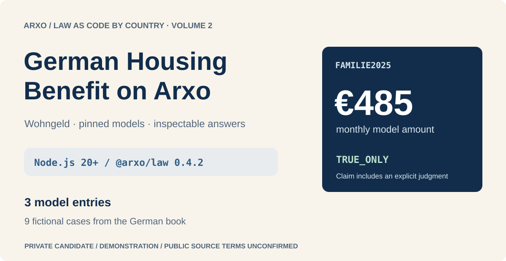
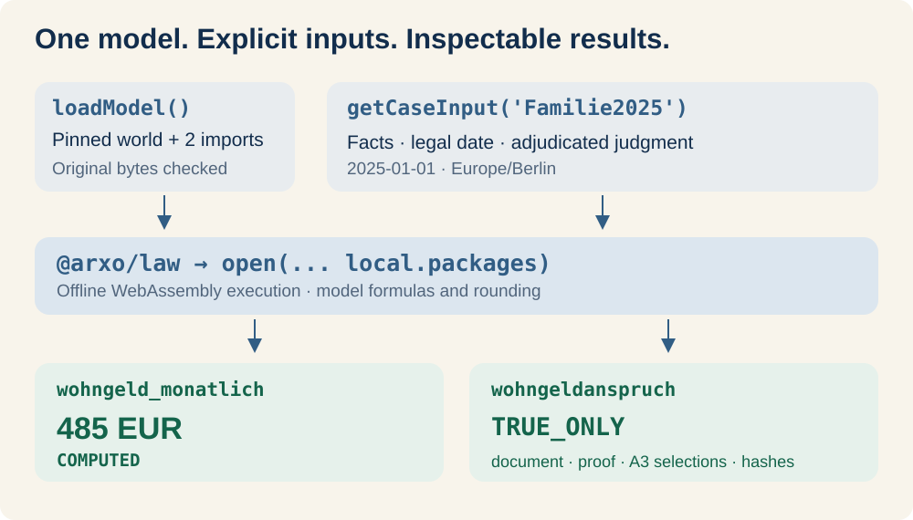
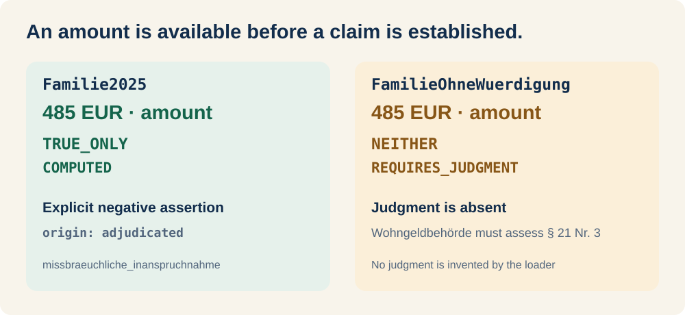
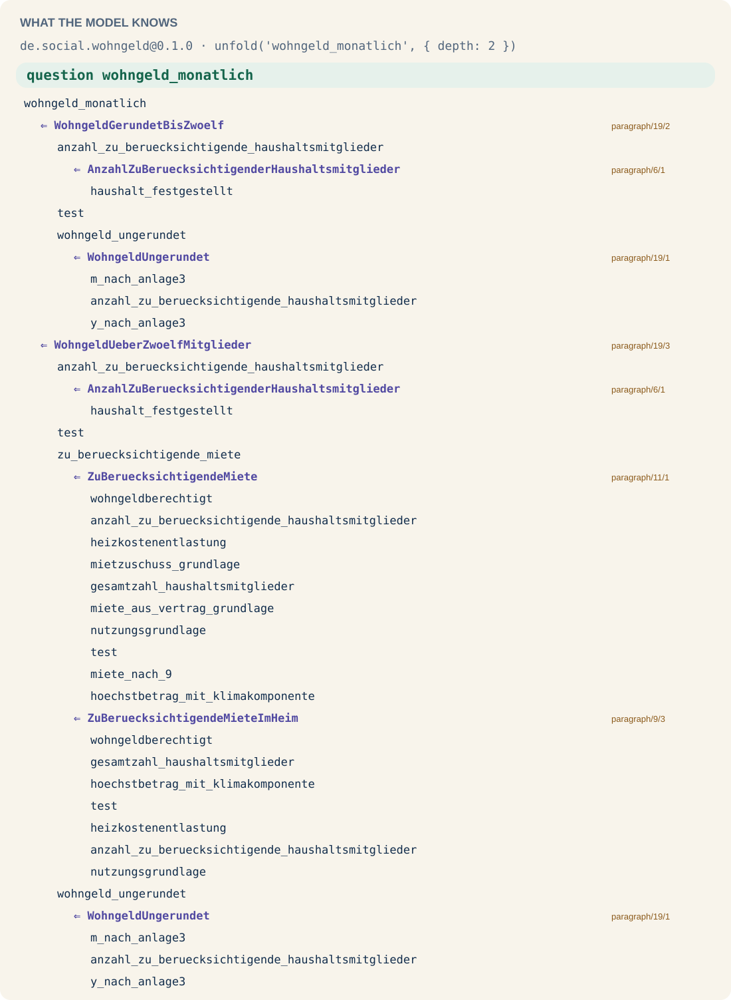

# German Housing Benefit on Arxo

**Three pinned models for exploring German Mietzuschuss, with nine fictional cases from the German Law as Code book.** Load a model in Node.js, ask for an amount or claim, then inspect its canonical evidence.

**Public source · npm 0.1.0 · models 0.1.0 · semantics law.core/0.2.11**

[Node.js quick start](npm/README.md#start-in-nodejs) · [Models](#models-and-formalization-depth) · [Book cases](https://github.com/arxohq/law-as-code-germany-examples) · [Evidence](npm/README.md#inspect-the-evidence) · [Reproduction](npm/PUBLISHING.md)

This independent open-source, noncommercial teaching and research demonstration does not claim legal accuracy or completeness and is not an implementation by or for a German authority. For an actual application, rely on official texts and the competent Wohngeld office.

## Run the published Node.js package

In a fresh directory, install the published model distribution and exact SDK:

```sh
npm init -y
npm install --ignore-scripts @arxo/canon-de-wohngeld@0.1.0 @arxo/law@0.4.2
```

Save as `example.mjs`, then run `node example.mjs`:

```js
import { open } from '@arxo/law';
import { loadModel } from '@arxo/canon-de-wohngeld/wohngeld';
import { household, getCaseInput } from '@arxo/canon-de-wohngeld/examples/familie-weimar';

const model = await loadModel();
const wohngeld = await open(model.spec, {
  offline: true,
  local: { packages: { [model.spec]: model.package } },
});
const input = getCaseInput('Familie2025');
const amount = await wohngeld.collect('wohngeld_monatlich', [household, '?amount'], input);
console.log(amount.evaluationStatus, amount.value); // COMPUTED, Money 485 EUR
const claim = await wohngeld.truth('wohngeldanspruch', [household, '485 EUR'], input);
console.log(claim.evaluationStatus, claim.truthStatus); // COMPUTED, TRUE_ONLY
```

Node.js 20+, ESM. The exact SDK 0.4.2 executes the model through engine 0.5.2. No formulas or parameter tables are reimplemented in the loader. [Full npm guide](npm/README.md) includes complete inputs, API/error behavior, all nine cases and strict TypeScript use.



## Models and formalization depth

| Package / npm suffix | Scope | Measured paragraph editions | Executable | Source only | NONE | Unmeasured publications |
|---|---|---:|---:|---:|---:|---:|
| `de.social.wohngeld` · `/wohngeld` | Selected Mietzuschuss rules and amount/claim | 157 (52 + 52 + 53) | 57 | 9 | 91 | 7 |
| `de.social.wohngeld_verordnung` · `/wohngeld-verordnung` | Rent components, Mietenstufen | 22 | 3 | 0 | 19 | 3 |
| `de.tax.income_for_wohngeld` · `/income-for-wohngeld` | Selected EStG income rules | 239 | 9 | 0 | 230 | 1 |

All three depth results are **partial**. The existing `boundaries.depth` measure uses own package nodes and byte-matched consolidated GII paragraph inventories, with distinct editions counted separately. The denominator includes paragraphs outside the chosen model scope. Executable units do not imply complete formalization. Annex tables, amendments, BMWSB examples and scripts remain unmeasured; in particular, this does not grade WoGG Anlagen 1–3 or the WoGV Mietenstufen annex. `INTERPRETED` and `ANCHORED` counts are zero.

[Unit-level report with source and implementation hashes](npm/assets/formalization-depth.json) · [Scope and measurement explanation](npm/README.md#formalization-depth).

The pinned export records 87 + 18 + 12 successful scenarios. A separate new CLI 0.2.2 run passed the same 117. SDK, installed archive and strict type checks are separate evidence. Full corpus: `not_checked`; `releaseVerified: false`.

## The amount and the claim

The complete baseline input yields €1,710 income, €777.80 counted rent and €485 a month. The claim includes an explicit negative misuse judgment with `origin: adjudicated`. With that judgment absent, the amount remains €485 but the claim is `NEITHER / REQUIRES_JUDGMENT`. Missing facts, negative facts and conflicts have distinct statuses. These models declare institutional predicates and no deontic positions.



For `V20270101`, the SDK returns an empty amount with `MISSING_PARAMETER_VALUE` issues and `evaluationStatus: COMPUTED`. Handle the issues and empty value explicitly. Do not substitute zero or reuse a previous amount. [All cases and chapters](npm/README.md#explore-the-book-cases).

## Answers and native model view

Preserve `answer.document` as canonical bytes. For these SDK queries, `answer.sources` is empty; A3 row selections and function source anchors are retained in `answer.proof.nodes[].attributes`. [Copyable evidence inspection](npm/README.md#inspect-the-evidence) shows the exact path. Parameter choices follow the legal date; static anchors can name several retained editions.

<details>
<summary>What the model knows: native unfold at depth 2</summary>



[Full native tree and text](npm/assets/wohngeld-unfold.json). This is a model view without a selected case; recursion depth is not formalization depth.

</details>

## Source pins and provenance

Models: `d1887e87da88682930460b10deb9f52870ef5d54` in this repository. Cases: `9575dcba842d1b7da310300e2bcfbe3f1cb87ff9` in `law-as-code-germany-examples`. [Source pin](npm/source-pin.json) records them separately and preserves original CLIR/world/descriptor/catalog bytes.

The public companion repositories retain the original source pins, model bytes and attribution. [npm release](https://www.npmjs.com/package/@arxo/canon-de-wohngeld) 0.1.0 was delivered through [CI](https://github.com/arxo-io/law/actions/runs/38434723524); its public archive, anonymous installation, SDK examples, strict types and visual assets were checked. The [source inventory](npm/PUBLICATION-BOUNDARY.json) preserves the original publisher-text review and the maintainer’s distribution decision. Publisher texts keep the terms described in NOTICE; the code licence does not replace them.

## Existing CLI and registry workflow

The original source workflow remains available below; npm preparation uses pinned registry bytes and does not rebuild the live corpus.

## How it is verified

Every package is built by `package.py` with the pinned toolchain: compilation,
§267 scenarios on both evaluators, replay of saved evaluations and a rebuild
from the release itself. A failure of any step stops the build.

```sh
python3 tools/toolchain.py download --lock toolchain.lock.json --out /tmp/law-tools
python3 /tmp/law-tools/package.py packages/<name> \
    --lawc /tmp/law-tools/law-cli --offline --out /tmp/<name>-release
```

## Dependencies

Dependency bytes are pinned under `packages/<name>/deps/` and verified against the hash recorded in `law.lock`: the build and the CI are offline.

## Installing from this repository

`registry/` publishes these packages and their closure (3) in the
layout of the Arxo registry: descriptors, canonical CLIR bytes (§208), worlds and
resources. A case package whose `law.lock` pins them installs from a clone:

```sh
law install --registry arxo=<path to the clone>/registry
```

The sources are `packages/<name>/`; the registry copy does not repeat them.
`python3 registry/check_registry.py` verifies schemas, addresses and hashes.

## Rights

Code and model: see `LICENSE`. The pinned texts of the publishers keep their
own terms of reproduction, listed per package in `NOTICE`; those terms are
not covered by the code licence.

Maintainer: Rifat Dzhumagulov (hi@arxo.io). Address: https://github.com/arxohq/arxo-wohngeld.
